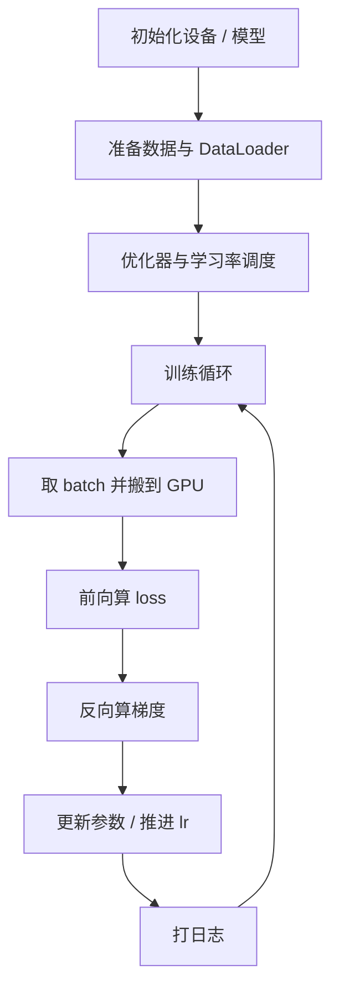

# 单卡 GPU 训练

这是一份「标准」的单卡训练脚本。它不做任何分布式操作，目标是尽量简单。

本指南后面的内容都以这份代码为基础。这一章借单卡脚本把**完整训练流程**讲清楚，代码是载体，不是目的。

目录结构：

```text
01-single-gpu/
├── README.md
├── train_llm.py    # 参数、模型、优化器、训练循环、日志、显存
├── data.py         # 加载 / 分词 / 切块
└── checkpoint.py   # 实验目录、保存与恢复
```

## 运行代码

```bash
cd distributed-training-guide/01-single-gpu
python train_llm.py -d tatsu-lab/alpaca -m openai-community/gpt2
```

训练参数从命令行传入（`argparse`）。必填的是数据集 `-d/--dataset-name` 和模型 `-m/--model-name`；`-e/--experiment-name` 可省略（省略则不存盘、不续训）。完整列表见 `python train_llm.py --help`。

启动时会配置 Python 内置 `logging`（默认 INFO，输出到标准输出/标准错误）。环境变量与解析后的 `args` 用 `LOGGER.debug(...)` 记录，默认看不到；需要排查多机环境时把级别调到 DEBUG。后面多节点时，核对各机环境是否一致会很有用。

## 训练流程概览

一次训练的主体流程：

1. 选定 GPU / bf16，设随机种子，初始化模型（可 `torch.compile`）
2. 加载并预处理数据，构建 `DataLoader`
3. 创建优化器与学习率调度器
4. 进入训练循环：取 batch → 前向 → 反向 → 更新参数 → 打日志



检查点与断点续训属于工程配套（可选），下文单独说明，不放进主体流程。

## 训练流程详解

### 1. 初始化模型与设备

使用 PyTorch 时，在初始化其他对象之前有几件有用的事要做：

```python
device = torch.device("cuda")
dtype = torch.bfloat16
torch.manual_seed(args.seed)
```

这里指定脚本其余部分使用 GPU（具体是 CUDA 设备），并用 bfloat16（也叫 bf16）训练。它是 16 位浮点数；float 是 32 位，double 是 64 位。

我们用 `transformers` 训练一个 BF16 因果语言模型（可以把它理解成 GPT）。脚本里用 `with device:` 在 GPU 上直接建模型，而不是先在 CPU 建好再 `.to(device)`：

```python
with device:
    # 只加载配置，不下载权重；use_cache=False 关掉 KV Cache（训练不需要）
    config = AutoConfig.from_pretrained(args.model_name, use_cache=False)
    # 按配置随机初始化（本指南练的是未训练模型，不是加载预训练权重）
    model = AutoModelForCausalLM.from_config(config, dtype=dtype)
```

`with device:` 是 PyTorch 的设备上下文：块内**新创建**的张量/参数默认建在该 device 上，所以 `from_config` 时权重一开始就在 CUDA。

和 `.to(device)` 比，主要好处：

| | `with device:` 里直接建 | 先建再 `.to(device)` |
|---|---|---|
| 显存 | 只在 GPU 上占一份 | 常先在 CPU 建好，再拷到 GPU，峰值≈两份 |
| 速度 | 少一次整模拷贝 | 大模型搬迁更慢 |
| 写法 | 创建时就定好设备 | 创建 + 再搬一次 |

大模型时「先 CPU 再 `.to("cuda")`」很容易短暂爆内存；`with device:` 从源头就在 GPU 上分配，更省峰值。

注意：这只优化**初始化**（更快、峰值更低），**不加速后续训练**。模型已经在 CUDA 上之后，forward / backward 速度与用 `.to(device)` 搬过去的相同。它也只影响块内新建的对象；DataLoader 在 CPU 上拼出的 batch，训练循环里仍要 `.to(device, non_blocking=True)`（见下文）。

模型建好之后，脚本还会做一步：

```python
model = torch.compile(model)
```

很多「传统」教程 / 老脚本**不会**写这一行。原因很简单：`torch.compile` 是 PyTorch 2.0 才正式推广的；在那之前，训练循环里直接 `outputs = model(**batch)` 就是标准写法，功能完全够用。本指南从单卡开始就打开它，是为了让后面各章在相近写法下尽量吃到吞吐收益。

它做什么：把模型的前向（以及参与编译的反向路径）编译成更高效的执行图（默认后端多为 TorchInductor），减少 Python 开销、融合部分算子。多数情况下能**加速训练**，属于「改一行就可能变快」的优化。

代价与注意：

- **首次**跑若干 step 会偏慢（要追踪、编译）；编译完成后才是稳态速度。看吞吐时别拿最初几步当基准。
- 需要较新的 PyTorch（建议 2.x）和可用的 GPU 编译环境；出奇怪报错时，可先注释掉这一行做对比排查。
- 它加速的是**已在 GPU 上的计算**；和上面的 `with device:` 不同——后者只影响建模时的设备与峰值显存，不加速 step。

更激进的用法（连 `loss_function`、`optimizer.step` 一起 compile）会出现在后面章节，例如 [05-training-llama-405b](../05-training-llama-405b/README.md#torchcompile)。单卡这一章先掌握「整模 `torch.compile(model)`」即可。

### 2. 数据集与 DataLoader

数据相关逻辑在 `data.py`。我们用 `datasets` 加载并预处理数据。本指南的处理代码来自 https://github.com/huggingface/transformers/blob/v4.45.1/examples/pytorch/language-modeling/run_clm_no_trainer.py。

入口里调用：

```python
train_data = load_and_preprocess_data(args, config)
```

`load_and_preprocess_data` 会：加载数据集与分词器 → `map` 分词（可用 `num_proc` 多进程加速预处理）→ 按 `seq_length` 拼接并切块 → 构造 `labels`（Causal LM 下通常等于 `input_ids`）。`load_from_cache_file=True` 时，重复运行可直接读缓存。若想了解更多，建议直接查看 `datasets`。

`DataLoader` 仍在 `train_llm.py` 中构建（逻辑很短，不必再包一层）：

```python
dataloader = DataLoader(
    train_data,
    batch_size=args.batch_size,  # 每个 step 的样本数
    shuffle=True,  # 每个 epoch 打乱顺序
    drop_last=True,  # 丢掉不足一整批的尾巴，保证 batch 大小一致
    num_workers=2,  # 后台进程取数，与 GPU 计算重叠
    prefetch_factor=2,  # 每个 worker 预取几个 batch（需 num_workers>0）
    pin_memory=True,  # 页锁定内存，配合 .to(..., non_blocking=True) 做异步 H2D
    collate_fn=default_data_collator,  # 多条样本如何拼成一个 batch
)
```

- `shuffle`：训练一般 `True`；验证 / 测试用 `False`。要对齐复现时，除了 `torch.manual_seed`，最好再给 DataLoader 传固定的 `generator`；`num_workers>0` 时还要设 `worker_init_fn`，否则 batch 顺序仍可能对不齐。详见 [determinism](../related-topics/determinism/README.md)。
- `num_workers`：后台取数进程数；`prefetch_factor`：每个进程提前准备几个 batch。默认相当于 `num_workers=0`（主进程同步取数），GPU 容易空等。适当增大后，取数可与计算重叠，通常能加快训练中的数据加载。多机场景见 [优化数据加载](../related-topics/optimizing-data-loading/README.md)。
- `pin_memory`：默认 `False`。设为 `True` 后，batch 落在页锁定 CPU 内存，主机→GPU 拷贝可以走更快的 DMA，也是 `non_blocking` 异步拷贝的前提之一。
- `collate_fn`：不写则用 PyTorch 的 `default_collate`；这里显式用 HF 的 `default_data_collator`，和 Transformers 字段更合拍。

### 3. 优化器与学习率调度

训练一步的核心是：算出 loss → `backward` 得到梯度 → **优化器**按梯度改参数。优化器决定「怎么根据梯度更新权重」。

```python
optimizer = torch.optim.AdamW(model.parameters(), lr=args.lr, fused=True)
```

- `model.parameters()`：要更新的模型参数。
- `lr`：基础学习率（步长）；太大易不稳，太小收敛慢。
- `fused`：默认 `False`；`True` 走融合 CUDA kernel，更新通常更快。本指南各章都显式打开。

学习率不必全程固定。**学习率调度器**（lr_scheduler）在训练过程中调整 `optimizer` 的 lr。这里用余弦退火：从当前 lr 按余弦曲线降到 `eta_min`。

```python
lr_scheduler = torch.optim.lr_scheduler.CosineAnnealingLR(
    optimizer, T_max=1000, eta_min=args.lr * 1e-2
)
```

- `optimizer`：要调度哪一个优化器。
- `T_max`：余弦半周期的 step 数；此处为示例取值。
- `eta_min`：学习率下限，这里取 `args.lr * 1e-2`。

训练循环里常见顺序是：`optimizer.step()` 用当前学习率更新参数，再 `lr_scheduler.step()` 调度器步数 +1，按余弦规则算出下一步的学习率并写回优化器。不调用后者的话，学习率会一直停在初始值。

### 4. 训练循环

标准写法是直接 `enumerate(dataloader)`，每步取出一个 batch 再搬到 GPU：

```python
for i_step, batch in enumerate(dataloader):
    if i_step < state["epoch_step"]:
        continue

    batch = {
        k: v.to(device=device, non_blocking=True) for k, v in batch.items()
    }
```

- `enumerate`：同时拿到本 epoch 内的步号 `i_step` 和数据 `batch`。
- `i_step < state["epoch_step"]` 时 `continue`：断点续训用。`epoch_step` 记录中断前已训到哪一步；前面的步只跳过训练，但 `enumerate` 仍会按同样顺序取到 batch，这样在 `shuffle=True` 时后面接着训的样本顺序才对得上。
- `.to(device, non_blocking=True)`：按 batch 从 CPU 拷到 GPU（不是整库常驻显存）。`non_blocking=True` 让拷贝异步提交，常与 DataLoader 的 `pin_memory=True` 一起用，便于和 GPU 计算重叠；GPU 真正用到这些张量时，流上仍会等拷完。注意这里的 `.items()` 是字典遍历，不是会强制同步的 `tensor.item()`。

标准的一步训练：

```python
outputs = model(**batch)
outputs.loss.backward()

optimizer.step()
lr_scheduler.step()
optimizer.zero_grad(set_to_none=True)
```

- `model(**batch)`：前向。把 `input_ids` / `labels` 等送进模型，算出 logits 和 `loss`（Causal LM 会按下一个 token 预测算交叉熵）。
- `loss.backward()`：反向。沿计算图反传，把梯度写到各参数的 `.grad`。
- `optimizer.step()`：用**当前**学习率和刚算出的梯度更新权重。
- `lr_scheduler.step()`：调度器步数 +1，按规则把学习率改成**下一步**要用的值。
- `optimizer.zero_grad(set_to_none=True)`：清掉 `.grad`；`set_to_none=True` 置 `None` 更省显存（1.x 默认填 0，2.0+ 默认已是 `True`）。

顺序记成：前向 → 反向 → 更新参数 → 推进学习率 → 清梯度，准备下一步。

#### 日志与训练指标

记录频率由 `--log-freq` 决定。例如 `--log-freq 100` 表示每 100 步记录一次（step、lr、平均 loss、显存等）。

每步用 `running_loss += outputs.loss.detach().float()` 在 GPU 上累加，一般不强制同步；只在打日志时 `.item()` 一次，把同步次数从「每步」降到「每 log_freq 步」。

```python
running_loss += outputs.loss.detach().float()

if state["global_step"] % args.log_freq == 0:
    info = {
        "global_step": state["global_step"],
        "lr": lr_scheduler.get_last_lr()[0],
        "running_loss": (running_loss / args.log_freq).item(),
        "epoch": state["epoch"],
        "epoch_progress": state["epoch_step"] / len(dataloader),
        "num_batches_remaining": len(dataloader) - i_step,
        **get_mem_stats(device),
    }

    LOGGER.info(info)
    torch.cuda.reset_peak_memory_stats(device)  # 清峰值计数，下一段 peak_* 只反映本窗口
    running_loss.zero_()
```

`get_mem_stats` 仍留在 `train_llm.py`，用于读取当前 / 峰值显存。打日志后 `reset_peak_memory_stats` 只重置统计、不释放显存，一般也不触发计算同步。

### 5. 检查点与断点续训

相关逻辑在 `checkpoint.py`。传了 `--experiment-name` 才开启存盘与续训；检查点目录为 `args.save_dir/args.experiment_name`，实验名是一次运行的**唯一**标识。

```python
is_experiment, exp_dir = resolve_experiment_dir(args)
```

`state` 记录训练进度（与权重分开存）：

```python
state = {
    "epoch": 0,
    "global_step": 0,
    "epoch_step": 0,
}
# loss 在 GPU 上累加，不放进 state（避免每步 .item() 同步，也无法直接写入 JSON）
running_loss = torch.zeros((), device=device, dtype=torch.float32)
```

若目录里已有 `state.json`，启动时会恢复模型、优化器、调度器与进度（**在训练循环之前**）：

```python
if is_experiment:
    state, resumed = resume_if_available(
        exp_dir, device, model, optimizer, lr_scheduler, state
    )
    ensure_experiment_dir(exp_dir)
```

加载时使用 `map_location=device` 与 `weights_only=True`（降低恶意 pickle 风险）。旧 checkpoint 若含 `running_loss` 字段会丢弃，累加器不落盘。

循环中每隔 `--ckpt-freq` 步保存一次。除了模型，还要保存优化器和学习率调度器：

```python
if is_experiment and state["global_step"] % args.ckpt_freq == 0:
    save_checkpoint(exp_dir, model, optimizer, lr_scheduler, state)
```

`save_checkpoint` 会写入 `model.pt` / `optimizer.pt` / `lr_scheduler.pt` / `state.json`。有 `state.json` 时，下次用同一实验名启动才会走恢复逻辑。

## 本章小结

- 单卡脚本刻意保持简单，作为后续分布式章节的共同起点。
- 主体流程是：**设备与模型 → 数据 → 优化器 → 训练一步（含日志）**；检查点是可选工程配套。
- 工程外壳（参数、logging 初始化、实验目录）够用即可，不必喧宾夺主。
- 代码按职责拆成 `train_llm.py` / `data.py` / `checkpoint.py`，阅读时仍以训练主线为准，代码只是讲解载体。
